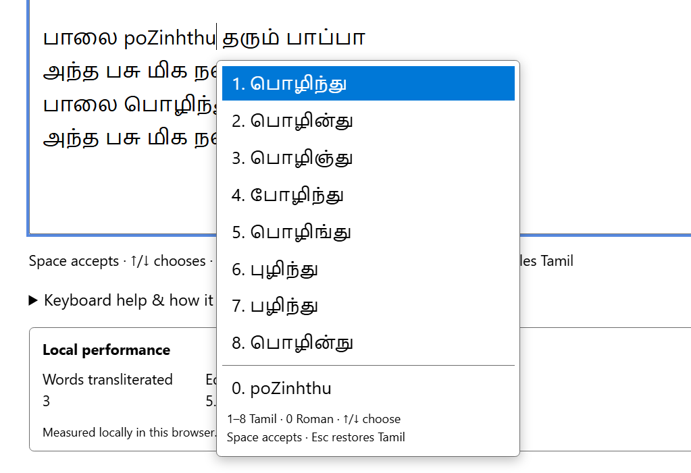

# தமிழில் எழுதுக (Browser-native Tamil transliterator)

**Can Tamil transliteration run entirely on-device inside a browser using
ONNX Runtime Web/WASM without requiring a server-side inference service?**

This standalone engineering artifact demonstrates that execution path. Type
a Roman word, inspect IndicXlit's Tamil proposals, and explicitly choose what
enters the document. A local Web Worker runs the bundled FP32 models through
ONNX Runtime Web's WASM CPU provider.

Everything required to execute is committed. The static host serves files;
inference and user text stay in the browser. Running the demo requires no
inference API, cloud service, CDN, package restore, Python, or .NET.



## What makes the boundary interesting

The model returns suggestions; it does not own the document. The controller
must distinguish a current proposal from a stale asynchronous result, retain
explicit acceptance while typing continues, and make Tamil re-edit reversible.

The artifact separates those concerns:

```text
Browser UI and controller
    -> local Web Worker
    -> committed ONNX Runtime Web/WASM
    -> committed IndicXlit encoder, decoder and vocabularies
    -> raw Top-8 -> display normalization -> identity ranking seam
    -> visible choices -> explicit document mutation
```

The ranking seam preserves the model's order. It marks the boundary between
neural inference and candidate policy without adding another ranking system.
Choice **0** is the user's literal Roman spelling, not a ninth model proposal.

## Who contributed what

| Contributor | Contribution |
|---|---|
| **AI4Bharat** | Created the original IndicXlit transliteration model, its architecture and pretrained weights. Transliteration quality originates from this upstream model. |
| **Microsoft** | Created ONNX Runtime Web, including the JavaScript/WASM inference runtime bundled here. |
| **Repository author** | Mechanically adapted the ONNX-compatible FP32 assets for execution under ONNX Runtime; implemented the execution environment, browser integration, worker architecture, beam search, interaction model, validation, standalone packaging and deployment path. |

The author **did not create or train the transliteration model and did not
design its architecture**. Asset adaptation was a runtime compatibility task,
not new model research or a claim of improved transliteration quality.
Detailed provenance and license links appear below.

## Run it

Clone this repository into any directory, open PowerShell there, and run:

```powershell
.\Serve.ps1
```

Open `http://127.0.0.1:17841/` in Edge and wait for **Ready**. Type a word such
as `naan` and choose a displayed Tamil proposal. Keep the terminal open;
Ctrl+C stops the static host.

If script execution policy blocks launch, use a process-scoped invocation:

```powershell
powershell -NoProfile -ExecutionPolicy Bypass -File .\Serve.ps1
```

`Serve.ps1` resolves files relative to itself and supplies the browser origin
and asset MIME types. The qualified path is Windows PowerShell or PowerShell 7
with Edge. The model runtime uses one WASM thread.

The models, vocabularies and ORT distribution total **60,527,212 bytes**
(about 60.5 MB decimal). They are ordinary Git-tracked files. Their inclusion
makes the clone the complete executable artifact.

## Typing and choosing

| Action | Result |
|---|---|
| Type a Roman word | Display up to eight Tamil proposals; text is unchanged until acceptance. |
| **1-8** or click a Tamil row | Commit that proposal without adding a separator. |
| **0** or click the literal row | Keep the current Roman spelling without adding a separator. |
| **Up/Down** | Explore the visible rows, including literal 0. |
| **Space** or punctuation | Accept the selected row and append the typed separator. |
| **Enter** | Normally accept candidate 1 and insert a newline. During explicit exploration, accept the selected row and insert a space. |
| **F6** or mode button | Toggle Tamil composition; F6 applies while the text box is focused. |
| **Ctrl+Space** | Explore a Roman word or reconsider an existing Tamil word through Roman spelling. |
| **Esc** | Restore the original Tamil during an active re-edit; otherwise dismiss proposals. |

After choosing 0, appending letters extends that Roman word and resumes
composition for its new spelling. Insert a separator to start a different
word. Numbered acceptance behaves similarly: it commits a word, not a space.

Ordinary selection, deletion, paste, mixed Tamil/Roman text and undo remain
textarea operations. Space can also accept a word while inference is pending:
the controller retains that explicit intent without letting a late result
replace text the user has changed.

## Reproducible validation

```powershell
.\tests\Run-BrowserTests.ps1
```

The runner verifies committed asset hashes and exercises the demo through
headless Edge with fresh browser profiles.

| Boundary | Evidence |
|---|---|
| Browser model execution | 30 known transliteration cases: expected raw candidate strings and order, plus FP32 scores within `1e-4`; six invalid-input cases. |
| Interaction and ownership | 139 editor assertions covering acceptance, re-edit, rollback, editing and stale/asynchronous results. |
| Connected-worker initialization failure | Existing nonempty mixed Tamil/Roman, multiline text remains exactly intact when the real worker cannot load its runtime; failure is visible and further editing works. |
| Resident local inference | Stop the static host, demonstrate a rejected fetch, then generate uncached Tamil candidates for a different word. |

These are execution and regression checks, not a linguistic quality benchmark
or proof of every browser/device combination. [VALIDATION.md](VALIDATION.md)
explains the corpus, test mechanisms, measurement scope and limitations.

## Inspect deeper

| File | Purpose |
|---|---|
| [ARCHITECTURE.md](ARCHITECTURE.md) | Responsibility boundaries, async ownership, beam search and reversible re-edit. |
| [VALIDATION.md](VALIDATION.md) | Reproducible commands, expected-output checks and precise evidence boundaries. |
| [app.js](app.js) | Composition, acceptance, document ownership and re-edit transactions. |
| [indicxlit-worker.js](indicxlit-worker.js) | Asset initialization, ONNX execution, beam search, normalization and request serialization. |
| [tests/validation-results.json](tests/validation-results.json) | Compact release-qualification snapshot with environment and scoped timing observations. |

The first-party browser runtime is seven files and 1,017 physical lines,
including comments and blanks. Most interaction complexity is in the
controller; most algorithmic complexity is in the worker's beam search.

## Static deployment

Publish `index.html`, `styles.css`, `app.js`, `textarea-caret.js`,
`performance.js`, `indicxlit-worker.js`, `assets/`, `runtime/`, `licenses/`
and `LICENSE` on a static HTTPS host. Keep their relative paths and notices.
Exclude `.git`, tests and generated evidence from the deployed page.

Qualification uses loopback hosting. Project-site relative URLs are supported
by the source layout, but a deployed GitHub Pages site is not part of the
qualification snapshot.

## Licensing and provenance

The authored browser integration, scripts and documentation use the
[MIT License](LICENSE), copyright 2026 Nandagopal Kirubanandan. The root
license does not replace upstream copyrights, licenses or notices.

**AI4Bharat IndicXlit v1.0:** [source](https://github.com/AI4Bharat/IndicXlit),
[release](https://github.com/AI4Bharat/IndicXlit/releases/tag/v1.0),
[checkpoint archive](https://github.com/AI4Bharat/IndicXlit/releases/download/v1.0/indicxlit-en-indic-v1.0.zip)
and [bundled MIT license](licenses/IndicXlit-LICENSE.txt).
The two FP32 ONNX assets derive from that checkpoint; the vocabulary files
derive from its vocabularies. Retain the upstream license with these assets.

**Microsoft ONNX Runtime Web 1.23.2:**
[source](https://github.com/microsoft/onnxruntime),
[pinned source](https://github.com/microsoft/onnxruntime/tree/v1.23.2),
[distribution](https://www.npmjs.com/package/onnxruntime-web/v/1.23.2),
[MIT license](licenses/ONNX-Runtime-LICENSE.txt) and
[third-party notices](licenses/ONNX-Runtime-ThirdPartyNotices.txt).
The bundled JS, MJS and WASM bytes are unchanged from this distribution.
Retain its license and notices.

IndicXlit requests citation of Madhani et al. (2022),
*Aksharantar: Towards building open transliteration tools for the next billion users*,
[arXiv:2205.03018](https://arxiv.org/abs/2205.03018).
The published paper is Madhani et al. (2023),
*Aksharantar: Open Indic-language Transliteration datasets and models for the Next Billion Users*,
*Findings of EMNLP 2023*, pages 40-57,
[ACL Anthology](https://aclanthology.org/2023.findings-emnlp.4/).
Credit for the research belongs to those authors; upstream endorsement is
not implied.
